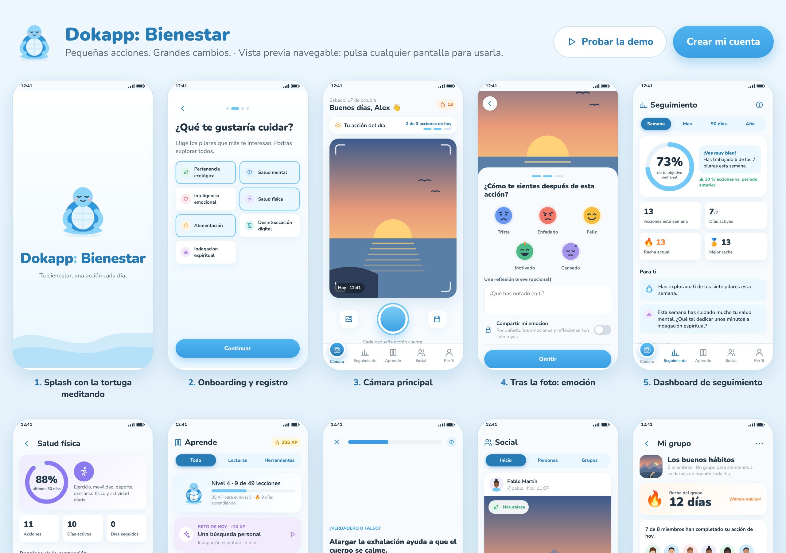

# Dokapp: Bienestar 🐢

**Pequeñas acciones. Grandes cambios.**

Dokapp es una red social de bienestar: cada día registras hasta **tres pequeñas acciones** con una foto, eliges uno de los **siete pilares del bienestar**, anotas cómo te sientes y compartes tu progreso con quien tú decidas. Aprendes con caminos tipo Duolingo y mantienes rachas con tus grupos, sin rankings ni comparaciones.



## Puesta en marcha

```bash
npm install
npm run dev          # http://localhost:5173
```

| URL | Qué abre |
| --- | --- |
| `/#/` | La app real. Sin configuración, guarda los datos en este dispositivo (localStorage + IndexedDB). |
| `/?demo#/` | La app con datos de demostración ("Alex", dos meses de historial). No guarda nada. |
| `/#/galeria` | Vista previa navegable de las 12 pantallas: pulsa cualquiera para usarla. |

Otros comandos:

```bash
npm test             # pruebas del dominio (puntuación, rachas, privacidad, límite diario)
npm run typecheck
npm run build        # app de producción en dist/
npm run build:single # todo en un único dist-single/index.html (abre en la galería)
npm run screenshots  # capturas en docs/screenshots (con `npm run dev` arrancado)
```

## Publicar gratis (Netlify + Supabase)

Guía paso a paso: [docs/DESPLIEGUE.md](docs/DESPLIEGUE.md). En resumen:

1. Ejecuta `supabase/schema.sql` en un proyecto gratuito de Supabase.
2. Ejecuta `npm run build` y rellena `dist/config.js` con la URL y la clave *anon*. `config.js` se lee al cargar la página, así que no hace falta recompilar.
3. Arrastra `dist/` a https://app.netlify.com/drop.

## Servidor propio (alternativa)

`server/index.mjs` es un servidor Node sin frameworks que sirve la app compilada y una API JSON sobre Postgres:

- Cuentas con correo y contraseña (scrypt), sesión en cookie `httpOnly`, protección CSRF por origen.
- Fotos guardadas en Postgres y servidas solo a quien puede verlas.
- La privacidad se aplica en cada consulta: acciones públicas, de grupo o privadas; emoción y reflexión nunca salen del autor salvo que comparta la emoción.
- Límite de tres acciones por día con bloqueo transaccional.
- El esquema (`server/schema.sql`) se aplica solo al arrancar.

```bash
npm run build:server                 # compila el cliente en modo API
DATABASE_URL=postgres://... npm start  # PORT=3000 por defecto
```

Variables: `DATABASE_URL`, `DATABASE_SSL=true` si la base de datos lo exige, `NODE_ENV=production` (cookies `Secure`).

En Render: servicio web Node con build `npm ci --include=dev && npm run build:server`, arranque `npm start` y una base de datos Postgres.

## Conectar Supabase (alternativa)

1. Crea un proyecto en Supabase y ejecuta [`supabase/schema.sql`](supabase/schema.sql) en el editor SQL.
2. Copia `.env.example` a `.env` y rellena `VITE_SUPABASE_URL` y `VITE_SUPABASE_ANON_KEY`.
3. `npm run dev`. La app usa entonces Supabase Auth, Postgres con RLS y un bucket privado `photos`.

El esquema incluye:

- **RLS en todas las tablas.** Cada acción es pública, solo de grupos o privada. La emoción y la reflexión viven en `action_private`, que solo lee su autor.
- **Límite de tres acciones al día**, aplicado con un trigger en la base de datos.
- **Rachas de grupo sin exponer contenido**: `group_activity()` devuelve solo recuentos por día.
- **Supresión de cuenta (RGPD)**: `delete_my_account()` borra la cuenta y, en cascada, todos sus datos.
- **Solicitudes de seguimiento** automáticas para perfiles privados y **unión a grupos por código**.

> El adaptador de Supabase (`src/data/supabaseBackend.ts`) implementa la misma interfaz que el backend local, que es el que cubren las pruebas. Todavía no se ha probado contra un proyecto Supabase real: conviene hacer una primera pasada manual al conectarlo.

## Qué incluye

- **Splash y onboarding**: tortuga meditando que respira, tres diapositivas, registro e inicio de sesión, perfil (nombre, usuario y foto), intereses, objetivos iniciales y privacidad del perfil.
- **Cámara (pestaña principal)**: cámara en vivo con `getUserMedia` (el permiso se pide solo al pulsar), cámara nativa como alternativa e importación desde la galería conservando la fecha EXIF original si quieres. Contador de "x de 3 acciones de hoy", racha, acciones del día, consejo diario y recordatorio amable.
- **Flujo de registro**: pilar y descripción → emoción (5 caras ilustradas) y reflexión privada → visibilidad (pública, solo grupos o privada) y comentarios → celebración de la tortuga.
- **Seguimiento**: índice global, filtros de semana, mes, 90 días y año, radar de siete ejes con comparación con el periodo anterior, barras por pilar, pilar más trabajado y por explorar, actividad, evolución emocional, recomendaciones basadas en reglas y detalle por pilar.
- **Algoritmo transparente** (`src/domain/scoring.ts`): 40 % frecuencia, 30 % constancia, 20 % objetivos y 10 % reflexión, normalizado de 0 a 100. El índice global es un 80 % la media de los pilares y un 20 % la diversidad. Los pesos se ajustan desde la app ("¿Cómo se calcula?").
- **Aprende**: 7 caminos × 7 lecciones con contenido real (tarjetas, preguntas, reflexión que se guarda en tu diario y reto), XP y niveles separados de las métricas de bienestar, lecciones desbloqueables, reto diario, lecturas recomendadas y herramientas (respiración cuadrada, temporizador, tres gratitudes, 5-4-3-2-1 y diario).
- **Social**: feed con apoyos y comentarios, búsqueda, seguir y dejar de seguir, solicitudes en perfiles privados y perfiles ajenos sin rankings.
- **Grupos**: creación, código de invitación, racha colectiva ("7 de 8 miembros han completado su acción de hoy"), pausas justificadas, días de descanso del grupo, días de descanso personales, objetivo común semanal, pilares del grupo, calendario colectivo y métricas individuales solo con consentimiento.
- **Perfil**: estadísticas, calendario mensual con puntos por pilar y detalle por día (borrar acciones, marcar descanso), metas con progreso y check-in manual, logros, edición del perfil y ajustes (exportar tus datos en JSON, cerrar sesión y eliminar la cuenta).

## Arquitectura

```
src/
  domain/      lógica pura y probada: tipos, pilares, puntuación, rachas, recomendaciones, logros, aprendizaje
  content/     lecciones, lecturas y consejos
  data/        interfaz Backend + LocalBackend (dispositivo/demo) + SupabaseBackend + comunidad demo
  lib/         imágenes (compresión y EXIF), fotos en IndexedDB, escenas ilustradas
  components/  tortuga, iconos, radar, calendario, UI base
  screens/     pantallas
  Gallery.tsx  vista previa de las 12 pantallas
supabase/schema.sql
tests/
```

## Privacidad y límites

- Las emociones y reflexiones son privadas por defecto. Las métricas individuales solo se ven en un grupo si lo consientes.
- Dokapp no analiza las fotos ni hace diagnósticos. Las puntuaciones miden participación y constancia, no la salud real, y las recomendaciones no son consejo médico.
- El modo local guarda todo en el navegador del dispositivo. Para una red social real entre dispositivos hace falta Supabase.

**Pendiente:** horarios individuales por miembro en las rachas de grupo, notificaciones push y moderación de comentarios en el servidor.
